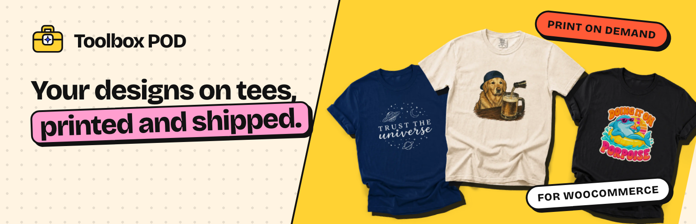

# Toolbox POD for WooCommerce

Print-on-demand apparel for your WooCommerce store. Publish your designs as products, and
[Toolbox POD](https://toolboxpod.com/) prints and ships each order from our own shop in Utah, with tracking.

**Install it from WordPress.org:** [wordpress.org/plugins/toolbox-pod-for-woocommerce](https://wordpress.org/plugins/toolbox-pod-for-woocommerce/),
or in your dashboard under Plugins → Add New Plugin, search "Toolbox POD". How it works with WooCommerce:
[toolboxpod.com/woocommerce](https://toolboxpod.com/woocommerce).

## What it does

- **Connect in one click.** You approve access on WooCommerce's own screen and can revoke it any time under
  WooCommerce → Settings → Advanced → REST API.
- **Publish products** with colors, sizes, prices and mockup photos from Toolbox POD straight to your store.
- **Orders go to production automatically.** Toolbox POD charges the card on your Toolbox POD account for the base
  cost; you keep the difference.
- **Tracking** is added to the order when it ships. Customers see it in My Account and in their order emails.
- **Checkout:** Toolbox POD products ship as their own package with one "Standard shipping" rate, on the classic
  checkout and the checkout block.
- **Size guide** tab on products with a size chart.
- **WooCommerce → Toolbox POD:** recent orders, revenue and profit, settings, store checks with a fix for each, and a
  support form.

Toolbox POD ships to US addresses only. The plugin does nothing until you click "Connect to Toolbox POD"; the
[readme](readme.txt) lists every request it makes and what each one carries.

## Requirements

- WordPress 7.0 or newer, PHP 7.4 or newer
- WooCommerce 11.0 or newer
- A Toolbox POD account (sign in or create one when you connect)

## About this repository

Each commit here is one released version, exactly as WordPress.org serves it, tagged `vX.Y.Z` with the zip attached
to its [release](https://github.com/Toolbox-POD/toolbox-pod-for-woocommerce/releases). The plugin is developed in a
private repository, so pull requests here can't be merged. Ideas and bug reports are welcome below.

## Support

- [WordPress.org support forum](https://wordpress.org/support/plugin/toolbox-pod-for-woocommerce/)
- The Support tab under WooCommerce → Toolbox POD, or email [support@toolboxpod.com](mailto:support@toolboxpod.com)
- Security issues: email [support@toolboxpod.com](mailto:support@toolboxpod.com) rather than posting in public.

## License

GPL-2.0-or-later. See [LICENSE](LICENSE).
